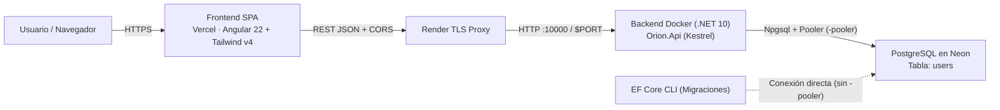
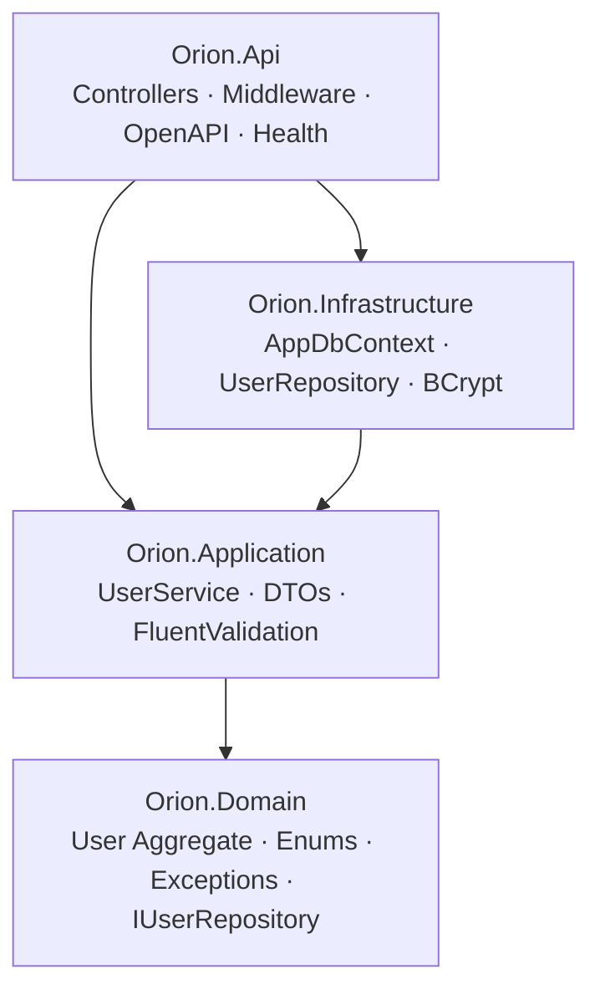

# ORION — Arquitectura del Proyecto

**ORION** es una plataforma gamificada de aprendizaje de programación con estética RPG retro de 16 bits. El repositorio está organizado como un monorepo con dos aplicaciones desacopladas: un frontend SPA en **Angular 22** y una API REST en **.NET 10** construida bajo **Clean Architecture**, respaldada por **PostgreSQL (Neon)** y preparada para despliegue en **Vercel** + **Render (Docker)**.

---

## 1. Arquitectura General del Sistema



### Topología del Repositorio

```text
Orion/
├── Api/                          # Backend .NET 10 (Root Directory en Render)
│   ├── Dockerfile                # Multi-stage build (sdk:10.0 -> aspnet:10.0)
│   ├── .dockerignore             # Excluye bin/, obj/, secretos y configs locales
│   ├── dotnet-tools.json         # Herramienta local dotnet-ef (v10.0.15)
│   ├── src/
│   │   ├── Orion.Domain/         # Entidades, enums, excepciones e interfaces de repositorio
│   │   ├── Orion.Application/    # Casos de uso, DTOs, validadores FluentValidation
│   │   ├── Orion.Infrastructure/ # EF Core, PostgreSQL (Npgsql), migraciones y BCrypt
│   │   ├── Orion.Api/            # Entrypoint REST, middlewares, OpenAPI/Swagger, CORS, /health
│   │   └── Orion.sln             # Solución .NET 10
│   └── tests/
│       └── Orion.UnitTests/      # Pruebas unitarias (xUnit + NSubstitute)
├── Frontend/                     # Frontend Angular 22 (desplegable en Vercel)
│   ├── src/app/
│   │   ├── views/                # Páginas lazy-loaded (home, login, register)
│   │   ├── components/           # Componentes standalone (landing, auth, shared)
│   │   ├── models/               # Contratos TS y validadores de runas de contraseña
│   │   └── data/                 # Datos estáticos de la landing RPG
│   └── src/styles.css            # Tema 16-bit en Tailwind CSS v4
├── AGENTS.MD                     # Guía operativa para agentes de código
└── README.MD                     # Documentación de arquitectura del proyecto
```

---

## 2. Arquitectura del Backend (`Api/` — Clean Architecture en .NET 10)

El backend separa estrictamente las reglas de negocio, la orquestación de casos de uso, la persistencia y el transporte HTTP:



### Responsabilidad por Capa

| Capa / Proyecto | Responsabilidad | Dependencias principales |
| :--- | :--- | :--- |
| **`Orion.Domain`** | Modela el agregado `User` (identidad, proveedor `AuthProvider`, rol `UserRole`, plan `PlanType`, estado RPG inicial Nivel 1 y soft-delete), reglas invariantes (`DomainException`), normalización de email/username y contrato `IUserRepository`. | Sin paquetes externos (.NET 10 puro) |
| **`Orion.Application`** | Implementa casos de uso en `UserService` (registro con generación automática de `username` único si se omite, consulta por ID, paginación, actualización de perfil, soft-delete), DTOs inmutables (`record`) y reglas de validación (`RegisterUserRequestValidator`, `UpdateUserProfileRequestValidator`, `PasswordRules`, `ProfileRules`). | `FluentValidation` (v12.2.0) |
| **`Orion.Infrastructure`** | Configura `AppDbContext` sobre PostgreSQL con reintentos ante fallos transitorios (`EnableRetryOnFailure`), mapeo Fluent API (`UserConfiguration`), migraciones (`InitialCreateUsers`), `UserRepository` y hashing seguro (`BcryptPasswordHasher` con work factor 12). | `Microsoft.EntityFrameworkCore`, `Npgsql.EntityFrameworkCore.PostgreSQL`, `BCrypt.Net-Next` (v4.2.0) |
| **`Orion.Api`** | Expone endpoints REST y `/health`, configura DI (`AddApplication`, `AddInfrastructure`), CORS dinámico (`FrontendClient`), OpenAPI + Swagger UI, y traduce excepciones a RFC 9457 `ProblemDetails` mediante `GlobalExceptionMiddleware`. | `Microsoft.AspNetCore.OpenApi`, `Swashbuckle.AspNetCore.SwaggerUI` |
| **`Orion.UnitTests`** | Valida servicios, hash BCrypt y reglas de validación de forma aislada mediante mocks. | `xunit`, `NSubstitute`, `coverlet.collector` |

### Pipeline de Peticiones HTTP (`Program.cs`)

1. **Puerto de escucha:** Si existe la variable `PORT` (inyectada por Render), Kestrel escucha en `http://+:{PORT}`; por defecto en contenedor usa `ASPNETCORE_URLS=http://+:10000`.
2. **`GlobalExceptionMiddleware`:** Intercepta excepciones y responde con `ProblemDetails` (`400` validación/regla de dominio, `404` usuario no encontrado, `409` conflicto de email/username o restricción única PostgreSQL `23505`, `500` error interno).
3. **OpenAPI / Swagger UI:** Expone `/openapi/v1.json` y `/swagger` en `Development` o cuando `ENABLE_SWAGGER=true`.
4. **HTTPS Redirection:** Activo únicamente en `Development` para evitar bucles de redirección detrás del proxy HTTPS de Render.
5. **CORS (`FrontendClient`):** Permite `http://localhost:4200`, `https://localhost:4200` y los orígenes definidos en `AllowedOrigins`.
6. **Rutas expuestas:**
   - `GET /health` — Health check ligero para Render (`200 OK`).
   - `POST /api/auth/login`, `GET /api/auth/me`, `PUT /api/auth/password`, `DELETE /api/auth/session` — Autenticación local con JWT Bearer.
   - `GET /api/auth/github/login`, `GET /api/auth/github/callback` — Flujo GitHub OAuth con cookie `HttpOnly` (`SameSite=Lax`, `Secure` en producción) anti-CSRF, resolución de email privado (`/user/emails`), creación/vinculación de usuario y redirección `${FrontendRedirectUrl}?token={jwt}`.
   - `POST /api/users/register` — Registro local de aventurero (`201 Created`).
   - `GET /api/users/{id:guid}` — Consulta por identificador (`200 OK` / `404 Not Found`).
   - `GET /api/users?pageNumber=1&pageSize=10` — Listado paginado (`200 OK`).
   - `PUT /api/users/{id:guid}/profile` — Actualización de perfil (`200 OK`).
   - `DELETE /api/users/{id:guid}` — Soft-delete (`204 No Content`).

### Modelo de Persistencia (`users` en PostgreSQL / Neon)

- **Identidad y acceso:** `id` (`uuid` generado en dominio), `first_name`, `middle_name`, `email` (único), `username` (único), `avatar_url`, `password_hash`, `auth_provider` (`Local` | `GitHub`), `github_id` (índice único parcial `github_id IS NOT NULL`), `role` (`User` | `Admin`), `plan_type` (`Free` | `Pro` | `Family`), `accepted_terms_at`.
- **Estado RPG:** `total_xp` (`>= 0`), `current_level` (`>= 1`), `current_streak` (`>= 0`), `longest_streak` (`>= 0`), `gems` (`>= 0`), protegidos por el check constraint `ck_users_gamification_non_negative`.
- **Auditoría y borrado lógico:** `is_active` (con `HasQueryFilter(u => u.IsActive)` en EF Core), `created_at`, `updated_at` (UTC).
- **Soporte Neon:** En runtime la API utiliza el endpoint con **PgBouncer (`-pooler`)**; en tiempo de diseño (`AppDbContextFactory`), `dotnet ef` sustituye `-pooler.` por el endpoint directo para ejecutar migraciones sin bloqueos de PgBouncer.

---

## 3. Arquitectura del Frontend (`Frontend/` — Angular 22 + Tailwind CSS v4)

El frontend es una aplicación **Angular 22.3** basada en **Standalone Components**, detección de cambios **`OnPush`**, **Signals** y diseño pixel-art implementado sobre **Tailwind CSS v4** (`@theme` en `src/styles.css`).

### Vistas y Rutas (`src/app/app.routes.ts`)

| Ruta | Vista (Lazy-Loaded) | Propósito |
| :--- | :--- | :--- |
| `/` | `HomeComponent` | Landing RPG: barra de navegación, héroe interactivo con arena de batalla, mapa de zonas, inventario del gremio, tabla comparativa y CTA Save-Point. |
| `/home` | `LogHomeComponent` | Dashboard autenticado (`authGuard`) `CHOOSE YOUR QUEST`: topbar con racha, gemas, nivel y `@username` reales (`GET /api/auth/me`), barra lateral fija colapsable (`COURSES`, `MARKET`, `PROFILE`, `LOG OUT`) y los 5 cursos reales (`Python Fundamentals`, `Fullstack App Design`, `ASP.NET Core`, `Next.js`, `NestJS`) con desbloqueo dinámico por nivel. |
| `/login` | `LoginComponent` | Pantalla `[ SLOT 01: LOAD GAME ]` conectada a `POST /api/auth/login` (JWT) con asistente Pyxis en tiempo real y acceso a GitHub OAuth. |
| `/register` | `RegisterComponent` | Creación de personaje (`RegisterCardComponent`) conectada a `POST /api/users/register`, con validación en vivo de las 4 runas de contraseña (`CipherRequirementsComponent`). |
| `/auth/callback` | `AuthCallbackComponent` | Recepción de callback externo (`?token=...`), hidratación de sesión vía `GET /api/auth/me` y redirección a `/home`. |
| `/adventurers` | `AdventurersComponent` | Guild Roster: CRUD interactivo de aventureros conectado a `GET`, `PUT` y `DELETE /api/users`. |
| `**` | Redirección a `/` | Fallback a la página principal. |

### Organización Modular de UI

- **`components/dashboard/`:** `DashboardTopbarComponent`, `DashboardSidebarComponent`, `CourseTrackCardComponent`, `ElectiveGuildCardComponent`.
- **`components/landing/`:** `NavbarComponent`, `HeroSectionComponent`, `BattleArenaComponent`, `QuestMapComponent`, `ZoneCardComponent`, `GuildInventoryComponent`, `QuestingComparisonComponent`, `SavePointCtaComponent`, `FooterComponent`.
- **`components/auth/`:** `LoginCardComponent`, `RegisterCardComponent`, `CipherRequirementsComponent`, `FamiliarGuideCardComponent`.
- **`components/shared/`:** Primitivas reutilizables `PixelIconComponent` y `RetroButtonComponent`.
- **`services/`, `interceptors/`, `guards/` & `environments/`:** Un único `AuthService` centraliza `/api/auth` y `/api/users` contra `${environment.apiUrl}` (`https://orion-backend-yar4.onrender.com/api` en producción y `http://localhost:5092/api` en desarrollo local); `authInterceptor` adjunta automáticamente `Authorization: Bearer <token>` y limpia sesiones vencidas ante `401`.
- **`models/` & `data/`:** Tipado estricto (`auth.models.ts`, `course-catalog.models.ts`, `quest-landing.models.ts`, `user.models.ts`) y catálogos estructurados (`course-catalog.data.ts`, `quest-landing.data.ts`).

---

## 4. Despliegue e Infraestructura

| Servicio | Plataforma | Configuración clave |
| :--- | :--- | :--- |
| **Backend API** | **Render** (Web Service Docker) | `Root Directory`: `Api` · `Health Check Path`: `/health` · Puerto `10000` (o `$PORT`) |
| **Base de Datos** | **Neon** (PostgreSQL Serverless) | Variable `ConnectionStrings__DefaultConnection` con cadena `-pooler` y `SSL Mode=Require` |
| **Frontend SPA** | **Vercel** | Directorio `Frontend` · Su dominio productivo debe declararse en `AllowedOrigins` del backend |

### Variables de Entorno del Backend (Producción)

- `ConnectionStrings__DefaultConnection` — Cadena de conexión PostgreSQL en Neon (obligatoria al arranque).
- `AllowedOrigins` — Orígenes permitidos por CORS (ej. `https://tu-frontend.vercel.app`, separados por coma si hay más de uno).
- `ENABLE_SWAGGER` — `"true"` para habilitar `/swagger` y `/openapi/v1.json` en producción.
- `ASPNETCORE_ENVIRONMENT` — `Production` por defecto en el contenedor.

---

## 5. Arranque Rápido en Local

### Backend (.NET 10)
```bash
dotnet test Api/src/Orion.sln
dotnet run --project Api/src/Orion.Api/Orion.Api.csproj
# API: http://localhost:5092 | Swagger: http://localhost:5092/swagger
```

### Contenedor Docker (Backend)
```bash
cd Api
docker build -t orion-api:local .
docker run --rm -p 10000:10000 \
  -e ASPNETCORE_ENVIRONMENT=Production \
  -e ENABLE_SWAGGER=true \
  -e AllowedOrigins="https://tu-frontend.vercel.app" \
  -e ConnectionStrings__DefaultConnection="Host=<NEON_POOLER_HOST>;Port=5432;Database=neondb;Username=<USER>;Password=<PASS>;SSL Mode=Require;Trust Server Certificate=true;" \
  orion-api:local
```

### Frontend (Angular 22)
```bash
cd Frontend
npm install
npm start
# App: http://localhost:4200
```
